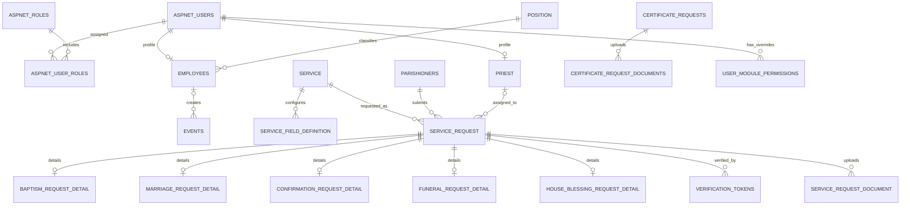

# Thesis Defense Guide: Santo Domingo Parish Website

This guide is based on the source code, SQL schema, and project documentation in this repository. It is intended to help explain the project accurately during a thesis defense. Where the repository does not establish a measured value or deployment fact, the guide identifies it as an unknown or recommendation rather than presenting it as a tested result.

## 1. Project overview

### Project title

**Santo Domingo Parish Website and Administration System**

### Project summary

The project is a responsive, browser-based parish information and operations system. It combines a public website for parishioners with a staff-only administration workspace. The public website provides parish information and online request forms. The administration workspace lets authorized staff review requests and manage parish content, appointments, sacramental records, schedules, and selected finance workflows.

The main technical components are:

- **Frontend:** React 19, TypeScript 6, Vite 8, React Router 7, Bootstrap 5, and FullCalendar.
- **Backend:** Node.js and Express 5, exposing HTTP API endpoints.
- **Database:** Microsoft SQL Server, accessed using the `mssql` Node.js driver.
- **Integrations:** Azure Blob Storage for production uploads and optional Resend email delivery.
- **Deployment described in the project documentation:** Vercel for the static frontend and Render for the persistent API service.

### Problem and project objective

The system addresses the need to make parish information and common administrative request processes available through a single web application. Its objective is to let parishioners find information and submit requests online, while providing staff with a controlled workspace to process those submissions and maintain parish information.

Present this as the system's intended purpose. The repository does not contain a formal needs-assessment report, measured before-and-after processing times, or user-study results; do not claim those results unless you have separate evidence.

## 2. Project design

### Architectural design

The application uses a three-tier web architecture:

```text
Browser: parishioner or staff user
            |
            | HTTPS/HTTP requests, JSON, and multipart file uploads
            v
React + TypeScript frontend
            |
            | REST-style Express API
            v
Node.js + Express backend
            |
            | SQL queries through mssql connection pool
            v
Microsoft SQL Server

Related integrations: Azure Blob Storage for production uploads;
                      Resend for configured email delivery.
```

1. **Presentation tier:** React pages render public content, online forms, and staff administration screens.
2. **Application tier:** Express routes receive requests, validate/process data, enforce access rules, and connect external services.
3. **Data tier:** SQL Server persists accounts, requests, records, content, schedules, finance data, and audit information.

The frontend API functions are centralized in [`parishweb/src/api/client.ts`](./parishweb/src/api/client.ts), while reusable data-fetching and mutation hooks are in [`parishweb/src/api/hooks.ts`](./parishweb/src/api/hooks.ts). The main API server is [`parishweb/server.js`](./parishweb/server.js); selected route groups are separated into modules under [`parishweb/src`](./parishweb/src).

### Example end-to-end workflow: service booking

Use this workflow to explain how the tiers cooperate:

1. A visitor opens the Services page and chooses a parish service.
2. The browser requests the service list, available appointment slots, and service-specific form definitions from the API.
3. The visitor supplies contact information, a date and time, and any service-specific details. A form may also include required or optional files.
4. The frontend submits the booking to the Express API. The API applies request and business-rule checks and writes the request and its related information to SQL Server.
5. Verification and review statuses let staff distinguish a submitted request from one that has been verified or approved.
6. Authorized staff can review the request, inspect its documents, update its status, and manage appointment availability.

The booking form is designed to be configurable: `ServiceFieldDefinition` stores field metadata, while typed detail tables hold common fields for baptism, marriage, confirmation, funeral, and house-blessing requests. This separates structured sacramental details from the general request record. See [`parishweb/migrations/016_sacrament_booking_fields.sql`](./parishweb/migrations/016_sacrament_booking_fields.sql) and [`parishweb/migrations/027_service_request_documents_and_review.sql`](./parishweb/migrations/027_service_request_documents_and_review.sql).

### Access control and operational design

- Staff authenticate before entering the administration workspace.
- Roles include Admin, Parish Priest, Secretary, Bookkeeper, and Staff.
- Role defaults and module-level permissions are used to control access to admin sections and actions. The frontend role definitions are in [`parishweb/src/utils/rbac.ts`](./parishweb/src/utils/rbac.ts); backend routes also use authentication and role checks.
- The server uses middleware and configuration for security headers, CORS, and API rate limiting.
- The project includes readiness endpoints. `/health` indicates that the API process responds; `/readyz` checks database readiness.
- The API process starts scheduled finance-report and appointment-cleanup jobs. The README warns against running multiple API instances while those jobs remain in the same process, because each instance could run duplicate schedules.

### Design strengths and trade-offs

**Strengths**

- Separates UI, API logic, and persistent data.
- Uses relational constraints for important links and uniqueness.
- Keeps sacrament-specific booking details in typed tables.
- Centralizes frontend API behavior, including consistent handling of API errors and uploaded files.
- Provides role-aware admin access and audit-oriented tables.
- Supports responsive pages and English/Tagalog interface/content in relevant areas.

**Trade-offs to discuss**

- The main Express file contains many routes, while some newer route groups are separated into modules. This is a practical hybrid structure rather than a fully modular backend.
- The system depends on a reachable SQL Server database for core data-driven behavior.
- Running scheduled jobs within the API process simplifies deployment but constrains horizontal scaling until the jobs are moved to a single worker or a distributed scheduler.
- The schema is SQL Server-specific; moving to another database would require adapting SQL and migrations.

## 3. E.R.D. — Entity Relationship Diagram

The diagram focuses on core entities and the relationships represented by the database schema. Optional (`o`) relationships indicate nullable foreign-key values; crow's-foot notation (`{`) means multiple related rows may exist.



### ERD explanation

- **Staff and permissions:** `AspNetUsers` contains staff identities. `AspNetRoles` and `AspNetUserRoles` associate users with roles. `Employees`, `Position`, and `Priest` hold staff-related profile information. `UserModulePermissions` stores per-user module overrides.
- **Service requests:** `Service` is the catalog of bookable services. It has configurable `ServiceFieldDefinition` rows and many `ServiceRequest` rows. Each request is submitted by a parishioner and can optionally be assigned to a priest.
- **Service-specific details:** Each typed detail table is keyed by the associated `ServiceRequestId`, providing a one-to-one extension for requests of that sacrament or service type.
- **Verification and documents:** `VerificationTokens` are related to a service request. `ServiceRequestDocument` stores request-specific uploaded file data and metadata. Certificate files use the separate `CertificateRequestDocuments` table.
- **Other system domains:** `Events`, `PrayerRequests`, `ContactMessages`, `SiteContent`, `MassSchedule`, `MassIntentions`, finance tables, sacramental record tables, archive tables, and audit tables represent other capabilities. Several of these are independent records without foreign keys to the entities shown.

### Database relationship caveat

Some associations that appear natural in application logic are not enforced as foreign keys in the baseline. For example, `CertificateRequests.AccountId` and `ParishionerAccounts.ParishionerId` are not shown with foreign-key constraints in the baseline. Do not draw those as database-enforced relationships unless you verify a newer live database schema. In the defense, distinguish a **logical association** from a **foreign key enforced by SQL Server**.

### Baseline schema status

The baseline [`parishweb/migrations/1000_current_database_baseline.sql`](./parishweb/migrations/1000_current_database_baseline.sql) has been reconciled with schema changes through migration `027`. It defines 42 tables, 20 foreign keys, and 6 triggers, along with indexes, defaults, and constraints. The baseline intentionally excludes parish records and the legacy-data transfer behavior from migration `003`.

The baseline is schema-only: service catalog entries and staff accounts are not automatically populated. [`parishweb/scripts/seed-service-catalog.sql`](./parishweb/scripts/seed-service-catalog.sql) provides an initial service catalog, while [`parishweb/create_admin_user.sql`](./parishweb/create_admin_user.sql) is a local development-only staff-account script.

## 4. Hardware specification

### What the repository establishes

This is a web system and does not require specialized client hardware such as a kiosk, scanner, or embedded device. Users access it through a modern web browser on a desktop, laptop, tablet, or smartphone. The repository documents runtime and hosting technologies, but it does **not** document the exact CPU, memory, or model of the development computer or production server.

| Component | Evidence in the project | Defense wording |
|---|---|---|
| Client device | Responsive browser-based React site | “Users need a modern browser and network access; no special client device is required.” |
| Local API runtime | Node.js; README recommends Node.js 22 LTS for local setup | “The backend runs as a Node.js process.” |
| Local database | SQL Server 2022 Developer or Express is documented for local setup | “SQL Server is the relational database used by the application.” |
| Frontend deployment | Vercel static site in deployment documentation | “The built frontend is hosted separately as a static site.” |
| API deployment | Persistent Node.js web service on Render in deployment documentation | “The API is a persistent service rather than a static frontend.” |
| Production uploads | Azure Blob Storage is required by documented production configuration | “Production file uploads use external durable object storage.” |
| Email | Resend integration is optional/configurable | “Email delivery depends on the configured provider and credentials.” |

### Do not present recommendations as measured requirements

No measured minimum or load-tested server configuration is specified in the repository. If the panel requires numerical hardware requirements:

1. Present your **actual development laptop/desktop** specification, which you should obtain from that device.
2. Present the **actual hosting plans** used for the defense/demo, if deployed.
3. If discussing a future production configuration, label it as a **proposed starting point**, not a tested system requirement. Size hosting after measuring expected concurrent users, database size, upload volume, and response times.

### Suggested verbal explanation

> “The project is a conventional web application, so the parishioner’s device only needs a modern browser and internet access. The server-side requirements are Node.js for the API and SQL Server for persistent data. Our documented deployment separates static frontend hosting from the API and uses Azure Blob Storage for durable production uploads. The repository does not contain benchmark results or a validated minimum CPU/RAM configuration, so I would not claim a tested hardware minimum.”

## 5. Coding and integration

### Frontend coding

- React components are organized into public pages, admin pages, and shared components.
- TypeScript is used for application UI and supporting utilities.
- React Router defines page navigation in [`parishweb/src/App.tsx`](./parishweb/src/App.tsx).
- [`parishweb/src/api/client.ts`](./parishweb/src/api/client.ts) centralizes HTTP calls, API base URL handling, admin-token headers, JSON requests, multipart uploads, and API error conversion.
- [`parishweb/src/api/hooks.ts`](./parishweb/src/api/hooks.ts) provides reusable hooks for loading data and submitting mutations.
- CSS is organized into application-level, page-level, and component-level styles.

### Backend coding

- Express provides the HTTP API endpoints.
- The `mssql` package connects API operations to SQL Server through a connection pool.
- `server.js` hosts the primary application and mounts route modules for areas such as prayer requests, blocked appointment slots, and administrative reporting.
- Shared business rules and helpers are separated into files such as `server-rules.js`, `certificate-availability.ts`, and `src/utils/rbac.ts`.
- API requests are logged, errors are handled centrally, and readiness checks are available.

### Database integration

- SQL Server tables represent users, role assignments, parishioners, events, service requests, typed request details, certificate requests, sacramental records, finance information, and site content.
- Primary keys provide stable row identity. Foreign keys and unique/check constraints enforce selected relationships and data rules.
- Indexes support common lookups such as service request relationships, certificate appointment searches, sacramental registry numbers, and audit timelines.
- SQL migrations track the evolution of the schema. `1000_current_database_baseline.sql` is the fresh-database schema; numbered migrations are incremental history and are not intended to be replayed over that baseline.

### External integrations

- **Azure Blob Storage:** production document/image upload storage in the deployment configuration.
- **Resend:** email integration for messages such as request confirmations and account/password flows when configured.
- **Vercel and Render:** separate deployment targets described by the project README.

### Example integration explanation

> “When the visitor submits a booking, the React form sends the data to an Express endpoint through our shared API client. The API validates the request and uses the SQL Server connection pool to save the request and its related details. For uploads, the browser sends multipart form data and the server stores the files using the configured storage approach. Staff then use protected admin endpoints to review the request and update its status.”

Describe this as the project’s implemented architecture. For production storage/email, state that actual use depends on the corresponding environment configuration and deployment.

## 6. Project structure

```text
parish/
├── package.json                     # npm workspace and root commands
├── README.md                        # setup, deployment, tests, and features
├── THESIS_DEFENSE_GUIDE.md          # this presentation guide
└── parishweb/
    ├── src/
    │   ├── api/                     # frontend API client and hooks
    │   ├── components/              # shared React components
    │   ├── pages/                   # public and administration pages
    │   ├── PagesCSS/                # page stylesheets
    │   ├── db/                      # typed SQL Server pool helpers
    │   ├── utils/                   # permissions, rules, logging, helpers
    │   └── ...                      # content, HTTP, and route modules
    ├── migrations/                  # SQL Server schema history and baseline
    ├── scripts/                     # local setup/maintenance scripts
    ├── server.js                    # main Express API
    ├── server-rules.js              # shared server-side business rules
    ├── package.json                 # app dependencies and scripts
    ├── vite.config.ts               # frontend build configuration
    └── vitest.config.ts             # test configuration
```

### How to explain the structure

- The **root** coordinates the npm workspace and exposes common commands.
- `parishweb/src/pages` contains route-level user screens.
- `parishweb/src/components` contains reusable interface elements.
- `parishweb/src/api` separates frontend network behavior from page rendering.
- `parishweb/server.js` and route modules implement the API.
- `parishweb/migrations` contains database schema scripts, including the consolidated baseline.
- `parishweb/scripts` contains utility scripts such as catalog seeding.

## 7. Project capabilities

### Public parish website

- Home page with parish highlights and event information.
- Parish information/about page.
- News and events browsing.
- Photo gallery.
- Service and sacrament information.
- Appointment booking with service-specific fields and availability.
- Certificate appointment requests, supporting documents, reference details, and request tracking.
- Contact form for sending messages to the parish.
- Prayer-request submission, with anonymity and community-sharing options and staff moderation.
- Bilingual FAQ chat with local keyword matching for service bookings, certificates, request tracking, prayer requests, and contact guidance. It uses curated answers, is not generative AI, and keeps messages only temporarily in the browser session rather than sending or persistently saving them.
- English and Tagalog support for translated interface/content where available.
- Responsive layouts for smaller screens.

### Staff administration

- Dashboard and event management, including Tagalog event fields.
- Website content editing for supported sections.
- Contact-message review and management.
- Mass schedule and Mass intention management.
- Service-request review, appointment availability, blocked slots, and booking-field configuration.
- Certificate appointment and supporting-document review.
- Sacramental records search and maintenance, plus archive file management.
- Finance entry and reporting workflows, including approval/reconciliation and audit information.
- Statistics and demographic summaries.
- Staff accounts, roles, module permissions, profiles, and password workflows.

### Operational features visible in the implementation

- Database readiness endpoint for checking API/database connectivity.
- API rate limiting and security-related HTTP middleware.
- Appointment slot conflict protection and blocked-slot management.
- Periodic finance-report snapshots and appointment cleanup/no-show processing.
- Automated tests using Vitest and Testing Library, plus ESLint and TypeScript/Vite build scripts.

Do not overstate these as proof of production-scale reliability. Automated unit/component/API tests are useful quality checks, but they are not the same as a live end-to-end test against a production SQL Server or a load test.

## 8. Suggested defense presentation sequence

### Slide 1 — Project overview

Introduce the parish website and staff administration system. Explain the two audiences: parishioners and authorized staff.

### Slide 2 — Problem and objective

Explain the goal of centralizing parish information and common request workflows. Use evidence from your own thesis research for any specific problem claims or impact measurements.

### Slide 3 — Project design

Show the browser → React frontend → Express API → SQL Server diagram. Briefly mention file storage and email integrations.

### Slide 4 — ERD

Start with `ServiceRequest`, `Service`, and `Parishioners`. Then explain the typed detail tables, document/verification entities, and staff permissions. Point out that the database enforces some links but not every logical association.

### Slide 5 — Coding and integration

Explain the centralized frontend API client, backend routes, SQL connection pool, and how uploaded documents are handled. Walk through one booking from submission to staff review.

### Slide 6 — Project structure

Show the top-level folders and explain the role of `src/pages`, `src/components`, `src/api`, `server.js`, `migrations`, and `scripts`.

### Slide 7 — Capabilities

Separate public functions from staff-only functions. Demonstrate the FAQ chat as a rule-based helper—not generative AI—alongside one public booking and one administrative review if a working demo environment is available.

### Slide 8 — Hardware and deployment

Explain browser-based access and show the actual local or hosted environment. Distinguish documented platform choices from specific hardware requirements; the repository does not specify measured CPU/RAM minima.

### Slide 9 — Limitations and future work

The FAQ answers are maintained in frontend code and do not automatically follow changes to admin-edited content, so they should be verified and updated by parish staff. Other potential areas include measured usability testing, production load/performance testing, separate scheduling workers, backup/restore drills, and formal evaluation. State only work that is genuinely future work for your team.

## 9. Possible panel questions and grounded answers

### “Why did you use a relational database?”

> “The application has related entities such as users and roles, service requests and their detail records, and requests and their documents. SQL Server supports explicit relationships, constraints, and indexes for those workflows.”

### “How do you prevent unauthorized staff access?”

> “The system authenticates staff and checks role/module permissions in the administration workflow. Protected API routes also apply authentication and role checks, so access control is not only a hidden/visible frontend menu.”

### “Does the FAQ chatbot use generative AI?”

> “No. It matches questions against a small set of approved English and Tagalog FAQs and returns prepared answers. It runs in the browser without an LLM or external AI service, keeps messages temporarily in the browser session without sending them to a service or saving them for later, and refers unmatched questions to the Contact Us page.”

### “How does the system avoid duplicate appointment bookings?”

> “The backend tracks active appointment slots and the database has a filtered unique index on the active slot key for service requests. The schema also defines a trigger for certificate appointment conflicts, and administrators can block dates or times.”

Do not imply every edge case has been load-tested; present the implemented safeguards and be ready to describe the tests your team actually ran.

### “Why are there separate detail tables for each sacrament?”

> “A shared service-request table handles common contact and appointment information. Separate detail tables keep sacrament-specific fields structured and queryable. Configurable field definitions allow some form changes without adding a database column for every custom field.”

### “What are the hardware requirements?”

> “The client requires a modern browser and network access; no special client hardware is required. The server-side software uses Node.js and SQL Server. Exact hardware sizing is not specified or benchmarked in the repository, so we use the actual deployment plan or describe a separately labeled recommendation.”

### “What are the system's limitations?”

> “The system depends on its API and database being available. Production capacity has not been established by the code repository alone. Scheduled tasks currently run within the API process, so scaling API instances requires relocating or coordinating those jobs.”

### “How did you verify the system?”

> “The project contains Vitest tests, Testing Library tests, ESLint, and a TypeScript/Vite build. Those checks cover automated test cases and compilation. A complete deployment evaluation should also include manual workflows against a running SQL Server, usability feedback, backup recovery checks, and performance tests where required.”

## 10. Final accuracy checklist

Before presenting:

- Confirm the database schema in your demo environment matches the current baseline.
- Use the ERD in this guide as a starting point, then verify it against the deployed database.
- Record the actual development computer and deployment-plan specifications if numeric hardware details are requested.
- Do not claim performance, reliability, usability, or time-saving percentages without test/evaluation data.
- Do not present optional Resend email or production Azure Storage as active unless configured in the demo/deployment.
- Keep credentials, connection strings, and real user records out of slides and screenshots.
- Distinguish implemented features from planned enhancements.
